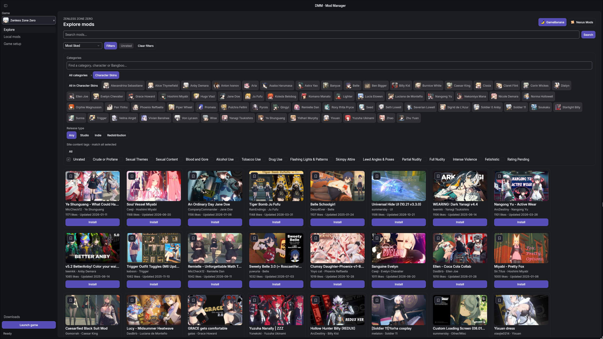

# DMM

A mod manager for ZZZ, Endfield, CP2077 and FF7RI, with support for Windows and Proton (SteamOS).

Supported games:

- Zenless Zone Zero (using XXMI; can be auto installed in Game Setup)
- Arknights: Endfield (using XXMI)
- Cyberpunk 2077 (experimental; note that mod requirements are not autofulfilled/checked)
- Final Fantasy 7 Remake Intergrade (experimental; only PAK mods)



Features:

- Online mod download from Game Banana and Nexus Mods (requires opening the browser)
- Setup ZZMI/EFMI/XXMI (ZZZ/Endfield mod loader)
- Linux support (currently only tested on NixOS and Steam versions)

Check releases for downloads.

## ZZZ/EF Fail to launch modded on Linux/Proton/SteamOS

Starting the game via XXMI started via DMM can use different Proton instance (shown as Steam not found, or when launching direct exe, the game immediately crashing). Copy the command to start XXMI from Steam via custom arguments, paste those in Steam into Properties (under gear icon/settings for the game) -> Launch arguments. Start XXMI there, and the game should launch properly.

Launch XXMI (from DMM) should be used to install ZZMI (i.e. launch XXMI, select ZZZ, and Install).

## Disclaimers

Currently only tested on Linux. Windows should work, given both games are running under Windows compatibility layer, and tests are running for it.

Code has been LLM generated, but mostly human read. I support using AI to improve workflows, not to replace artists and human creativity (and while I agree code can be art, my code was not). This is more of a personal tool that I didn't want to spend that much time on, releasing in hopes of it being useful to others. Feel free to ask for more games or features in Issues.

## Build

Use `nix develop` for the project's Rust toolchain and system libraries.

```sh
nix develop --command cargo build --locked
nix develop --command cargo test --locked
nix develop --command cargo build --locked --no-default-features # CLI only, see ./CLI.md
```

## Desktop app

```sh
nix develop --command cargo run --locked -- --state .dmm
```

The desktop and CLI store state in `$XDG_STATE_HOME/dmm` on Linux (`~/.local/state/dmm` if unset or relative) and `%LOCALAPPDATA%\dmm` on Windows. 
